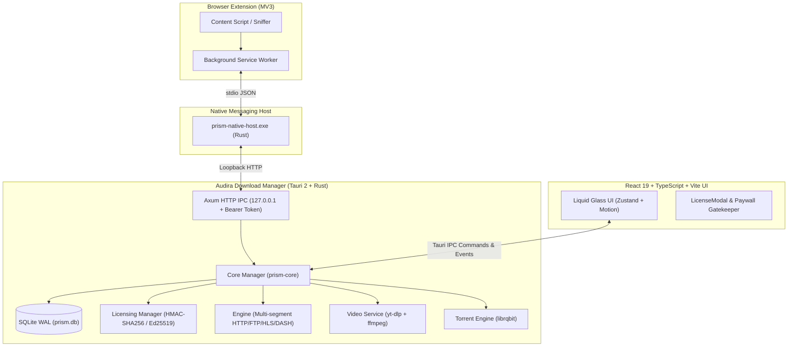

# 🏛️ System Architecture — Audira Download Manager (ADM)



---

## 1. Komponen Inti Monorepo

| Modul | Path | Bahasa | Fungsi Utama |
| :--- | :--- | :--- | :--- |
| **`crates/prism-engine`** | `crates/prism-engine/` | Rust | Mesin pengunduh multi-segmen paralel (work-stealing), token-bucket speed limiter, sparse writer NTFS. |
| **`crates/prism-core`** | `crates/prism-core/` | Rust | Logika bisnis, database SQLite, manajer antrean/penjadwal, dan **submodul lisensi kriptografis (`licensing.rs`)**. |
| **`crates/prism-native-host`** | `crates/prism-native-host/` | Rust | Binary jembatan Native Messaging browser dengan aplikasi desktop. |
| **`crates/prism-video`** | `crates/prism-video/` | Rust | Manajemen binary `yt-dlp` dan `ffmpeg` otomatis untuk ekstraksi audio/video streaming. |
| **`crates/prism-torrent`** | `crates/prism-torrent/` | Rust | Dukungan berkas torrent dan magnet links via `librqbit`. |
| **`app/`** | `app/` | TS / React 19 | Antarmuka desktop modern (Tauri 2) dengan modal aktivasi lisensi, tabel unduhan tervirtualisasi, dan sistem tema. |
| **`extension/`** | `extension/` | TS / MV3 | Ekstensi browser multi-browser (Chrome, Edge, Brave, Opera, Firefox). |

---

## 2. Arsitektur Mesin Lisensi (`crates/prism-core/src/licensing.rs`)

1. **Machine HWID**:
   Mengambil identifier unik perangkat (Windows: `HKLM\SOFTWARE\Microsoft\Cryptography\MachineGuid`; Linux: `/etc/machine-id`; macOS: hardware ID hash). Diformat sebagai `ADM-XXXX-XXXX-XXXX-XXXX`.
2. **Signature Formula**:
   ```
   Signature = SHA256(AUDIRA_SECRET_SALT + TIER + OWNER_NAME + EMAIL + EXPIRES_AT)[0..16]
   Key Format = ADM-<TIER>-<EXPIRES_AT>-<SIGNATURE>
   ```
3. **Enforcement Gate**:
   - `spawn_engine`: Membatasi jumlah koneksi per unduhan sesuai `license.maxConnections`.
   - `scheduler`: Mengunci aksi otomatis shutdown/sleep jika `!license.isPro`.
   - `video_probe`: Membatasi opsi kualitas resolusi di atas 1080p jika `!license.isPro`.

