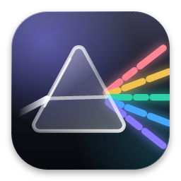
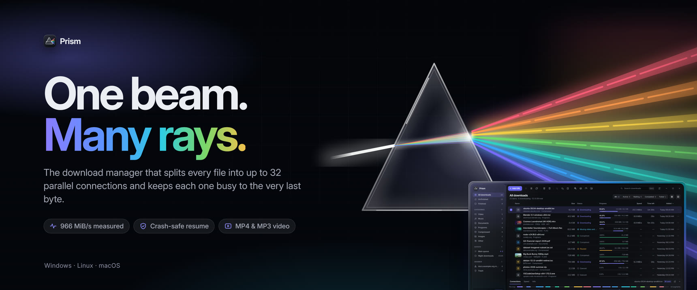
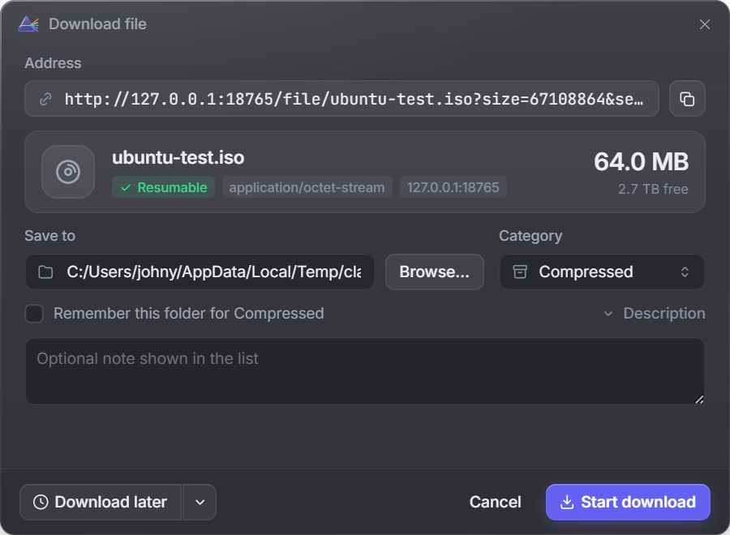
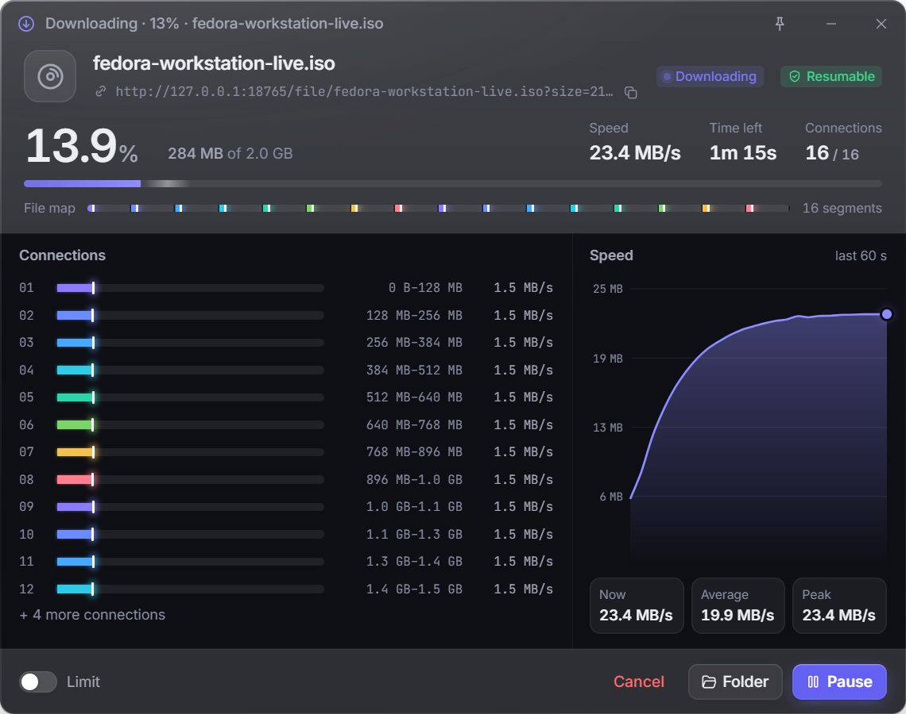
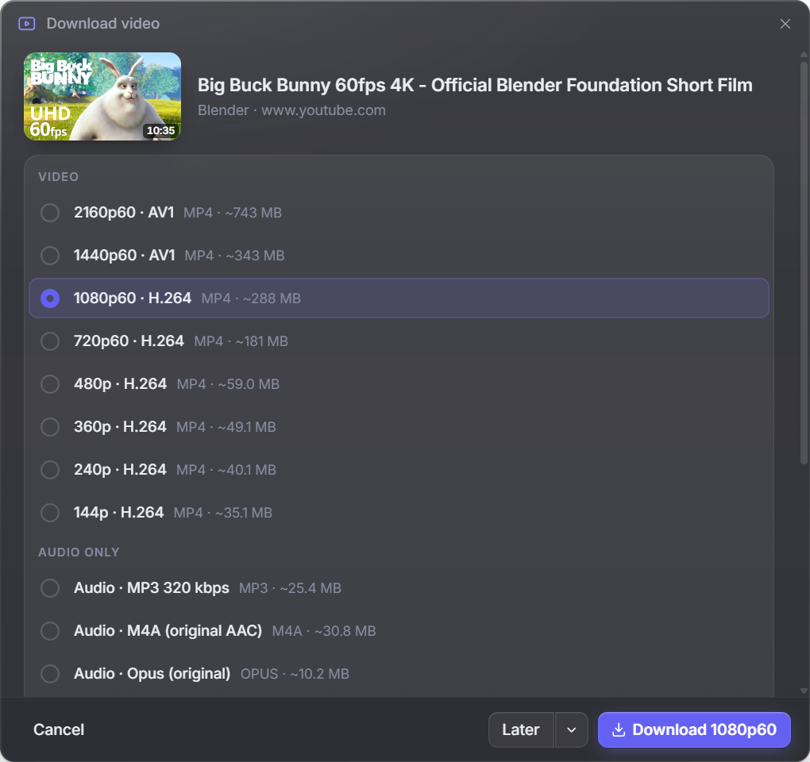
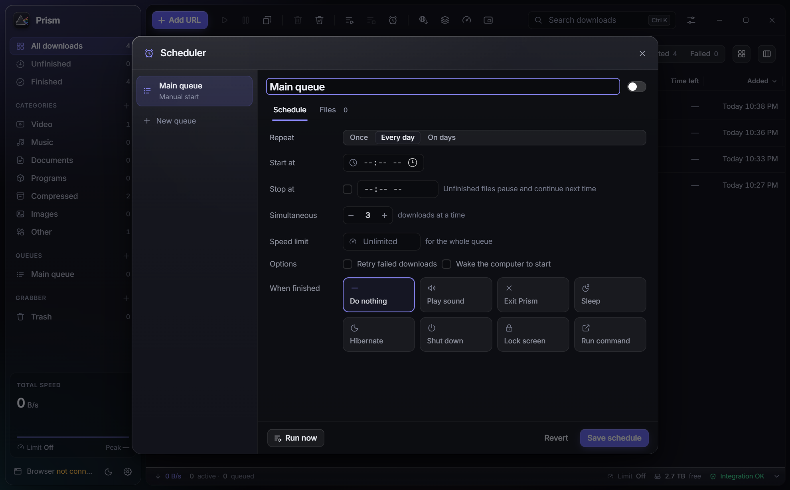
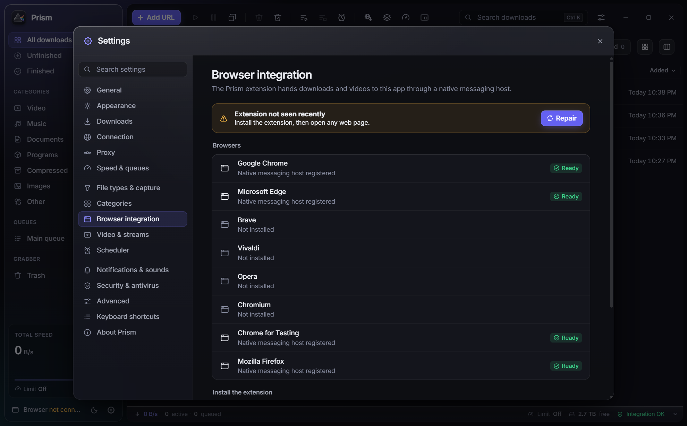
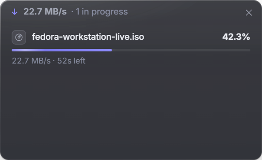
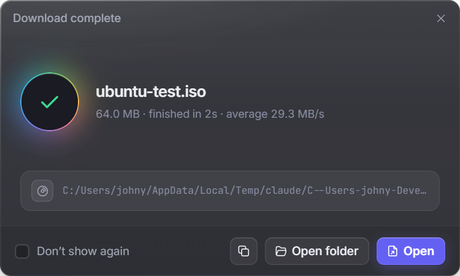

<p align="center">
  
</p>

<h1 align="center">Audira Download Manager (ADM)</h1>

<p align="center">
  <b>High-Performance Next-Generation Download Accelerator, 8K Video Grabber, and Local AI Model Hub</b><br>
  Built with Rust 2024, Tauri 2, and React. Engineered for maximum bandwidth utilization and zero-compromise privacy.
</p>

<p align="center">
  <a href="https://github.com/Audira141415/AUDIRA-DOWNLOAD/releases"></a>
  <a href="https://audira.my.id"></a>
  <a href="LICENSE"></a>
  
  <a href="https://wa.me/6282112001600"></a>
</p>

<p align="center">
  
</p>

---

## 📌 Ikhtisar Proyek (Project Overview)

**Audira Download Manager (ADM)** adalah perangkat lunak akselerasi unduhan generasi baru kelas industri yang dikembangkan oleh **Agus Dwi Rianto (AUDIRA MDA / ASM)**. ADM dirancang untuk mengatasi kelemahan pengunduh berkas konvensional dengan menggabungkan:

1. **Kernel Multi-Koneksi Turbo (Rust 2024)** dengan algoritma *Dynamic Work-Stealing* hingga **32 koneksi simultan**.
2. **Zero-Copy Sparse File Pre-Allocation** pada filesystem NTFS dan ext4 untuk mengeliminasi jeda perakitan berkas (*no temporary file merging delay*).
3. **Penangkap Media 8K & Audio Grabber** untuk lebih dari 1.800 portal video dan audio streaming.
4. **AI Model Harvester** langsung dari repositori Hugging Face (GGUF, SafeTensors) dengan verifikasi hash SHA-256 otomatis.
5. **Resiliensi Crash & Pemadaman Listrik** berbasis basis data terdistribusi SQLite Write-Ahead Logging (WAL).
6. **Ekstensi Browser Modern (Manifest V3)** untuk Google Chrome, Microsoft Edge, Brave, Opera, Vivaldi, dan Mozilla Firefox.
7. **Sistem Lisensi Kriptografis & Portal Manajemen Terpusat** dengan pengikatan unik Hardware ID (HWID).

---

## 📸 Galeri Antarmuka & Tangkapan Layar (Screenshots)

### 1. Kotak Dialog Pengunduhan Cepat (Download File Dialog)
Menampilkan deteksi otomatis nama file, ukuran, tipe MIME, pemilihan folder tujuan, serta alokasi segmen thread koneksi.

<p align="center">
  
</p>

---

### 2. Panel Detail & Telemetri Segmen Real-Time (Details Window)
Memvisualisasikan pemetaan blok byte secara real-time, kecepatan per segmen thread, grafik throughput, dan verifikasi checksum SHA-256.

<p align="center">
  
</p>

---

### 3. Ekstraksi Video & Audio Streaming 8K HDR (Video Grabber Dialog)
Mendeteksi resolusi video dari 360p hingga 8K HDR 60fps, subtitle multi-bahasa, serta konversi instan ke audio MP3 320kbps.

<p align="center">
  
</p>

---

### 4. Penjadwal Unduhan Otomatis & Antrean (Task Scheduler)
Mengatur waktu mulai unduhan otomatis, pembatasan kecepatan berdasarkan jam sibuk jaringan, serta perintah auto-shutdown / sleep komputer setelah selesai.

<p align="center">
  
</p>

---

### 5. Pengaturan & Integrasi Ekstensi Browser (Browser Integration)
Integrasi satu klik dengan browser favorit menggunakan jembatan Native Messaging host berkecepatan tinggi tanpa hambatan proxy.

<p align="center">
  
</p>

---

### 6. Floating Mini Widget & Notifikasi Selesai (Mini HUD & Complete Dialog)
Widget minimalis mengambang di atas layar untuk memantau unduhan aktif tanpa memakan ruang kerja.

<p align="center">
  
  &nbsp;&nbsp;
  
</p>

---

## 🛠️ Arsitektur Teknologi & Tech Stack

```
+-----------------------------------------------------------------------------------+
|                        AUDIRA DOWNLOAD MANAGER (ADM)                              |
+-----------------------------------------------------------------------------------+
|  PRESENTATION LAYER (UI/UX)                                                       |
|  - Tauri 2.12 Desktop Shell (Native Webview2 / WebKitGTK / WKWebView)            |
|  - React 19 + TypeScript 5.8 + Vite 6                                             |
|  - Swiss Minimalism & OLED Dark Design Tokens (tokens.css, no AI-slop)            |
|  - 8-Language Localization Catalog (ID, EN, AR, CS, DE, ES, FR, IT, TR)          |
+-----------------------------------------------------------------------------------+
|  BROWSER INTEGRATION LAYER                                                        |
|  - Chromium & Firefox Extensions (Manifest V3)                                    |
|  - High-Throughput Native Messaging Host (prism-native-host)                      |
|  - Context Menus ("Download with Audira") & Direct Video Stream Sniffing         |
+-----------------------------------------------------------------------------------+
|  CORE KERNEL ENGINE (RUST 2024)                                                   |
|  - prism-core        : State machine, task manager, licensing validation         |
|  - prism-engine      : Dynamic Work-Stealing, 32 parallel HTTP range connections  |
|  - Zero-Copy I/O     : Windows FSCTL_SET_SPARSE / Linux fallocate                 |
|  - prism-video       : Multi-platform streaming parser (HLS, DASH, MP4)           |
|  - prism-torrent     : BitTorrent metadata reader & piece verification            |
|  - Database Engine   : SQLite3 WAL with atomic checkpointing                      |
+-----------------------------------------------------------------------------------+
|  CENTRAL LICENSING & FLEET TELEMETRY SERVER                                       |
|  - Python 3 ThreadingHTTPServer (port 5050 / 5060)                                |
|  - Cryptographic Verification Engine (HMAC-SHA256, MachineGuid HWID Binding)      |
|  - Central Web Landing Page & Admin Fleet Management Portal (/admin)              |
+-----------------------------------------------------------------------------------+
```

### Rincian Modul & Bahasa Pemrograman:
* **Rust 2024 Edition (`crates/`)**:
  * `tokio` (Async runtime dengan scheduler multi-threaded).
  * `reqwest` & `hyper` (HTTP/1.1 dan HTTP/2 client dengan TLS mutakhir).
  * `sha2` & `hex` (Integritas kriptografi data chunk dan tanda tangan lisensi).
  * `windows-sys` / `winreg` (Akses langsung ke Windows Crypto Registry dan file system sparse).
* **Desktop Shell & Frontend (`app/`)**:
  * `Tauri 2.12` (Framework aplikasi desktop lintas platform hemat memori, footprint RAM < 45MB).
  * `React 19` + `TypeScript 5.8` + `Vite 6` (Kompilasi super cepat, modular, dan type-safe).
  * `Tailwind CSS v4` + Desain sistem Swiss Minimalism OLED Dark Mode.
* **Portal Server & Otentikasi (`server/`, `web/`)**:
  * Python 3 murni tanpa ketergantungan library luar (*zero external pip dependencies*).
  * Database relasional SQLite3 terenkripsi untuk pencatatan lisensi dan telemetri HWID.

---

## 💎 Skema Lisensi & Perbandingan Fitur

Audira Download Manager menerapkan model lisensi hybrid yang adil:

| Fitur Utama | Community Free Edition | Audira PRO Lifetime / Annual |
| :--- | :---: | :---: |
| **Koneksi Simultan per Unduhan** | Maksimal 6 Koneksi | **Hingga 32 Koneksi Turbo** |
| **Dynamic Work-Stealing Acceleration** | Terbatas | **Aktif Penuh (Otomatis)** |
| **Zero-Copy Sparse File Writing** | Aktif | **Aktif** |
| **Ekstraksi Video Streaming** | Maksimal 1080p | **4K & 8K HDR + Audio 320kbps** |
| **AI Model Hub (Hugging Face)** | Terbatas 1 Tugas | **Tanpa Batas (GGUF / SafeTensors)** |
| **Auto Sleep & PC Shutdown** | Tidak Tersedia | **Tersedia (Selesai Otomatis)** |
| **Pengikatan Lisensi HWID** | Tidak Ada | **Terkunci Kriptografis ke HWID** |
| **Dukungan Pelanggan** | Komunitas GitHub | **VIP Prioritas WhatsApp Langsung** |

### Format Serial Key Resmi AUDIRA:
```
ADM-[TIER]-[EXPIRES]-[SIGNATURE16]
Contoh: ADM-LIFE-0-D31E0A5C2D90475E
```
* **TIER**: `LIFE` (Lifetime seumur hidup) atau `YEAR` (Tahunan).
* **EXPIRES**: `0` untuk lisensi permanen atau Unix timestamp waktu kedaluwarsa.
* **SIGNATURE16**: 16 karakter heksadesimal hasil HMAC-SHA256 yang memvalidasi Nama Pemilik dan Email terdaftar.

---

## 🚀 Panduan Menjalankan & Membangun (Build Guide)

### 1. Prasyarat Sistem (Prerequisites)
* **Node.js**: v20.x atau v22.x LTS
* **Rust**: Rust 1.88+ (atau stable terbaru dengan toolchain `x86_64-pc-windows-msvc`)
* **Python**: Python 3.10+
* **C++ Build Tools**: Microsoft Visual Studio C++ Build Tools (untuk Windows)

### 2. Menjalankan Portal Server & Landing Page (Port 5050)
Server portal lokal menyediakan antarmuka web, verifikator lisensi online, dan dasbor admin:
```powershell
# Opsi 1: Menggunakan batch launcher
.\start-portal.bat

# Opsi 2: Menggunakan terminal
python server/adm_portal.py --port 5050
```
Buka di browser:
* **Landing Page & Cek Serial Key**: `http://localhost:5050/`
* **Portal Admin Manajemen Lisensi**: `http://localhost:5050/admin` *(User: `audira` | Pass: `Sigma1993`)*

### 3. Menjalankan Aplikasi Desktop dalam Mode Pengembangan (Dev Mode)
```powershell
# Opsi 1: Menggunakan batch launcher
.\start-adm-desktop.bat

# Opsi 2: Menjalankan manual
cd app
npm install
npm run tauri:dev
```

### 4. Membangun Biner Rilis Produksi (.exe)
Untuk memproduksi file instalasi Windows mandiri:
```powershell
# Membangun biner executable langsung
cargo build --release --bin audira-download-manager

# Membangun paket installer Tauri lengkap (NSIS / MSI)
cd app
npm run tauri:build
```
Hasil biner executable akan tersedia di `target/release/audira-download-manager.exe` dan bundle installer di `app/src-tauri/target/release/bundle/`.

### 5. Membangun Ekstensi Browser
```powershell
cd extension
npm install
npm run build
```
Paket ekstensi siap dimuat di `extension/build/chromium/` (untuk Chrome, Edge, Brave) dan `extension/build/firefox/`.

---

## 📂 Struktur Direktori Proyek

```
AUDIRA-DOWNLOAD/
├── app/                      # Aplikasi Desktop Tauri 2 & Frontend React
│   ├── src/                  # Kode sumber UI React 19 (Views, Windows, Dialogs)
│   ├── src-tauri/            # Tauri 2 Desktop Rust Shell (tauri.conf.json, main.rs)
│   └── package.json          # Skrip build Vite dan Tauri
├── crates/                   # Modul Rust Core Engine
│   ├── prism-core/           # Kernel utama, Database SQLite WAL, Licensing
│   ├── prism-engine/         # Dynamic work-stealing & Zero-copy sparse file I/O
│   ├── prism-native-host/    # Native messaging host untuk browser extensions
│   ├── prism-video/          # Video sniffer & stream extractor parser
│   ├── prism-torrent/        # BitTorrent metadata & piece verifier
│   └── prism-testserver/     # Server simulasi untuk uji benchmark throughput
├── extension/                # Ekstensi Browser WebExtensions (Chromium & Firefox)
├── server/                   # Central Licensing Server & REST API (Python 3)
│   ├── data/                 # Database SQLite3 lisensi dan telemetri
│   └── adm_portal.py         # Entrypoint server portal lisensi
├── web/                      # Aset Web Portal, Landing Page, CSS Swiss, JS App
├── docs/                     # Dokumentasi teknis, panduan, dan screenshots
├── marketing/                # Poster grafis, banners, dan logo pack
├── LICENSE                   # Lisensi Komersial Resmi Agus Dwi Rianto (AUDIRA)
├── THIRD_PARTY.md            # Pengakuan lisensi pustaka pihak ketiga
├── save.bat                  # Skrip otomatis simpan dan push ke repositori GitHub
├── start-adm-desktop.bat     # Launcher instan desktop client
├── start-portal.bat          # Launcher instan server portal lisensi
└── Cargo.toml                # Root Cargo Workspace konfigurasi
```

---

## 🛡️ Hak Cipta & Informasi Pengembang (Ownership & Support)

* **Arsitek & Pemilik Hak Cipta**: **Agus Dwi Rianto (AUDIRA MDA / ASM)**
* **Brand Studio**: **Audira Multimedia Digital & Audira Sukses Mandiri**
* **Owner ID**: `AUDIRA-ORIGIN-AGUS-DWI-R`
* **Kota Asal**: Batam, Kepulauan Riau, Indonesia
* **Website Resmi**: [https://audira.my.id](https://audira.my.id)
* **Hotline WhatsApp**: [+62 821-1200-1600](https://wa.me/6282112001600)
* **Email Resmi**: `agusdwirianto@gmail.com` | `support@audira.my.id`
* **Repositori GitHub**: [https://github.com/Audira141415/AUDIRA-DOWNLOAD.git](https://github.com/Audira141415/AUDIRA-DOWNLOAD.git)

---

<p align="center">
  <b>© 2026 Agus Dwi Rianto (AUDIRA). Hak Cipta Dilindungi Undang-Undang.</b><br>
  <i>Empowering High-Velocity Computing with Precision Software Engineering.</i>
</p>
